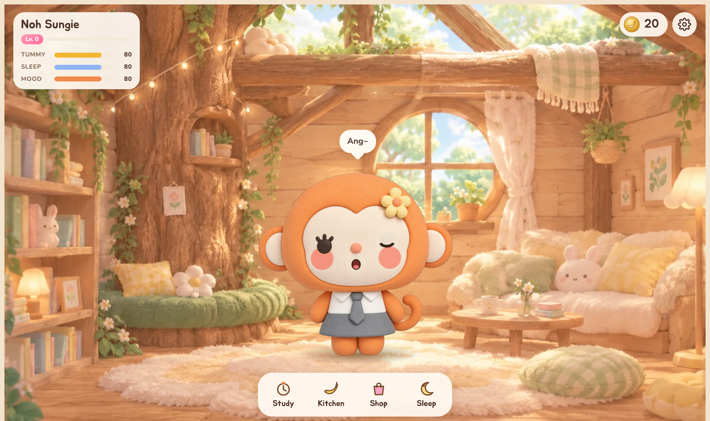

# Study with Sungie 🐒📚

A cozy study-buddy game. Noh Sungie lives in a tree house and keeps you company while you focus.

**▶ Play it:** open `index.html` in any browser, or visit the GitHub Pages link for this repo.

## What you can do

- **Study** with a focus/break timer (pick a length or type your own minutes) and earn coins for every session.
- **Feed** Sungie in the kitchen to keep her tummy and mood up. Her stats slowly change over real time, so check in now and then.
- **Dress her up** with outfits from the shop: school blazer, summer sailor uniform, GUUSS T shirts, green cardigan, the Sung-phrodite dress and more.
- **Open capsules** to collect friends and special treats.
- **Level up** as you study to unlock more food.
- Play in **English, 简体中文 or 繁體中文**, with light and dark themes.
- Progress saves in your browser. No account needed.

## How it's made

The whole game is a single `index.html` file (HTML, CSS and JavaScript with three.js for the scene), with the art embedded right in the page, so it runs anywhere with no install or build step.

Made by Katherine, with help from Claude.
